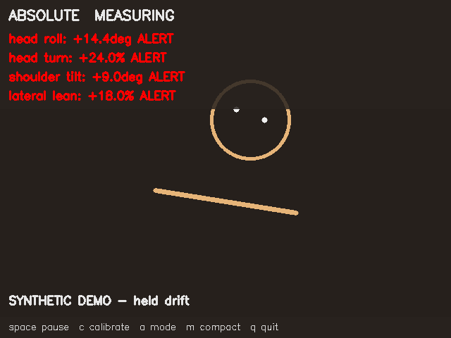

# Posture feedback

Posture feedback is a local tool for noticing head and shoulder drift while working at the computer. I built it to make it easier to stay aware of my posture without having to keep thinking about it. You can calibrate it to your sitting position and leave the camera preview open, with simple feedback when you drift from that position for a while. It is 100% local and private.



The preview uses demo data, not a real person in the imaeg :).

## Install

Download the [source ZIP](https://github.com/zackaryxu/posture-feedback/releases/download/v0.1.1/posture-feedback-0.1.1-source.zip), extract it, and run these commands from its folder:

```sh
python3.11 -m venv .venv
.venv/bin/python -m pip install .
```

## Use

```sh
./posture-monitor.command --demo
./posture-monitor.command --camera 0
```

Press `c` to calibrate, Space to pause, and `q` to quit. If the camera won't open check your camera permissions.

Measurements are approximate 2D feedback from ML, not a medical assessment or anything.

[License](LICENSE)
